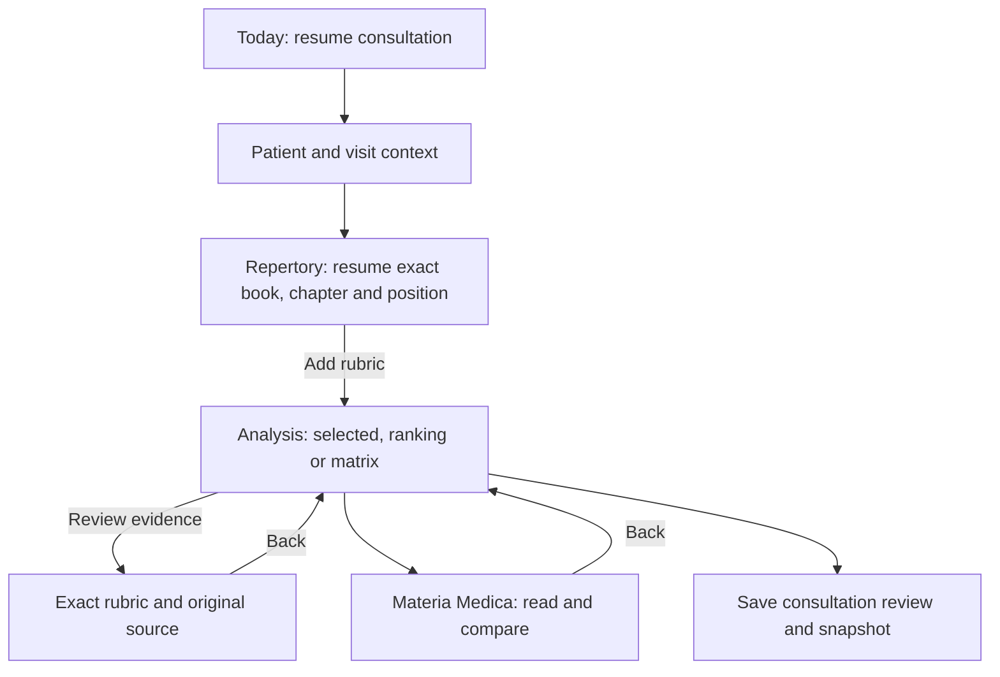

# Open Repertory: next UI and handling roadmap

Prepared 26 October 2026 for practising homeopaths using phones and tablets. Baseline: published 1.37. **This is a proposed implementation plan; its phases have not been added to the APK.** Modern repertory acquisition is a separate workstream and does not block UI improvements.

## Intended consultation flow

The main design goal is to preserve a clinician's place and context while moving through this flow. Frequent tasks should need a clear tap, with recovery from mistakes and visible saved-state feedback where work is edited.

## Preserve the decisions already made

- Keep the glass visual language, opaque clinical text/grade surfaces, optional solid mode and reduced-motion support.
- Keep the five phone destinations: Today, Repertory, Analysis, Patients and Library. Keep the floating clipboard icon without an Analysis word label.
- Keep the existing approved chapter pictures, chapter drawer behavior and source-specific identities. Show book names normally and provider names in Legal credits.
- Keep Repertory & reading at the top of the Repertory screen, visible only there. Keep its controls in that panel.
- Keep the removed backup banner and large unlinked-case strip out of the top of the app. Add no new always-visible toolbar row.
- Preserve the existing data, grades, scoring methods, encrypted records, approval policy, package/signing identity and free signed update channel.
- Retain the 1.37 source-review, Undo, clear confirmation and preferred-analysis-view improvements; they are the baseline, not new deliverables in this plan.

## Current evidence that sets the priorities

A read-only review used isolated desktop Chromium profiles and synthetic consultations built from existing English Kent rows. No native patient records or dataset files were changed. These are DOM/layout observations, not physical-phone speed measurements or clinical quality findings.

| Observation in 1.37 | Measured result | Consequence for the plan |
|---|---|---|
| Mind chapter with remedies hidden | Initially 264 rubric elements, 2,788 remedy buttons and 5,027 descendants | Hidden content still has a substantial rendering/memory footprint. |
| Three scrolls to the bottom of the growing list | 1,145 rubric elements, 12,184 remedy buttons and 21,811 descendants | The current renderer appends more nodes; long sessions need bounded rendering and lazy remedy mounting. |
| A 20-rubric sample case | 294 remedies scored; 120 columns displayed | Clinicians need a way to retrieve every scored remedy without placing all columns on screen. |
| Visible desktop importance buttons | 40 × 36 CSS pixels | The next layout should provide larger primary touch targets. Phone Matrix hides those controls by design. |
| Phone reading area at 393 × 850 | 599 px, about 70.5% of the viewport | Preserve this reading area while improving context and interaction. |

The review found no JavaScript exceptions in these two sampled browser flows. This is not an exhaustive bug-free claim. The [measurement record](docs/planning/2026-10-26/baseline-observations.json) contains counts and layout measurements only. The test screenshots remain in the development workspace.

## Phase 0 — baseline and task specification

**Deliverable:** a fixed set of clinical tasks and before/after measurements, with synthetic records and stable expected results.

Cover: resume an existing consultation; create a visit; find and add a rubric; review the original source and return; change importance; find a scored remedy outside the first displayed page; compare reference texts; save a snapshot; undo an edit; recover from a failed write; reopen after backgrounding or process death; restore an encrypted backup.

Record navigation steps, input response, frame stalls, DOM/heap growth and state restoration. Measure latency on a representative physical Android phone; use browser CPU slowdown and emulators for repeatable supplemental checks. Keep timing targets separate from demonstrated results. Capture hashes of all clinical assets and known scoring fixtures before implementation.

## Phase 1 — smoother repertory reading

**Priority: first implementation release.**

- Mount remedy buttons when a list is actually shown, instead of creating thousands of hidden buttons. Keep the underlying associations intact.
- Replace indefinite DOM growth with a window of visible rubrics and a small buffer. Retain a focused row and its needed ancestors so keyboard/TalkBack focus is not lost.
- Preserve expansion state and reading position by source ID and rubric ID/path, not by the row's changing screen index.
- Keep chapter pictures. Put book choice, chapter filtering and chapters on the existing whole-drawer scroll surface; no nested scroll trap.
- Use source-recorded parent links for hierarchy. Where a source only supplies paths, distinguish navigation grouping from verified parent relationships. Preserve the original full path and cross-references.
- Keep dense remedy text available; offer a full-name/grade detail sheet with accessible rows for users who find small inline abbreviations difficult to tap.

**Acceptance:** first, middle and last chapter entries remain reachable; grades and remedy lists match the baseline. As an initial target, keep hidden-remedy list descendants below 2,500 after twenty screen lengths, then tune from actual device measurements. No accumulated scroll jumps, stale highlights, missed references or lost expanded branches. A screen-reader-friendly paging fallback remains available if virtualization cannot preserve accessibility.

## Phase 2 — consultation context and navigation

- Use one compact header on clinical screens: brand mark, screen title, short case reference and Tools. Place the case switcher within that existing height, with an alias by default and no additional patient strip.
- Open a patient/case sheet from the case reference. Clearly identify the current visit and active case before confirming a switch.
- Keep separate browsing state for each case: book, chapter, query, expansion state and anchor. Store this as UI state without rewriting a rubric's clinical source.
- Provide explicit Back behavior through keyboard, dialog, chapter drawer, source reference, reader and workspace history. Check Android gesture/predictive Back on current Android versions.
- Restore the visible page and anchor after background return; provide deliberate restoration after process death when access is valid. Continue to lock clinical access when the device locks.

**Acceptance:** switching A → B → A restores A's context and browsing anchor. Equal rubric labels from different books remain distinct. A late request cannot move the user into the wrong case, book or screen. On the baseline phone size, keep at least the current reading-area proportion with the keyboard/finder closed, allowing an accessible large-text layout when needed.

## Phase 3 — faster finding and easier analysis

- Add local search history and favourites keyed to original source/rubric identity. Separate source-recorded alternate names from any optional text-matching suggestion; a suggestion never silently changes the chosen rubric.
- Make search scope clear: current chapter or whole book. Restore the query, filter and scroll anchor after opening a result and returning.
- Add Find scored remedy across the full computed result set. Page/window the displayed matrix and allow a few remedy columns to be pinned for comparison; show displayed and total counts.
- Keep Selected, Ranking and Matrix. Use the preferred view already saved in 1.37. Keep original rubric grades distinct from importance, filters and calculated scores.
- Explain a remedy excluded by the grade filter separately from a remedy absent from the selected source record. The scoring calculation remains unchanged.
- Keep Undo, refresh-on-save-failure and case-specific Clear all confirmation. Make expired recovery actions leave the keyboard focus order and keep an action available while it has focus.

**Acceptance:** the sample's remedy ranked beyond 120 is searchable and reviewable. Sorting/filtering displayed results never alters stored selections or their calculated scores. Every display method matches the frozen scoring fixtures. All primary actions have at least 44 × 44 px touch targets and a visible keyboard focus state.

## Phase 4 — patient files and Materia Medica

- Make Today a working list: active consultation, recent cases and visits, with optional guidance that stays dismissed.
- Make Patient → Visit → Case relationships clear in the existing Overview/Visits/Cases/Notes structure. Show saved/pending/failed feedback next to the edited content; preserve drafts on errors.
- Extend the Library reader with within-text search, source/section navigation and a remembered reading anchor for each remedy and volume.
- Keep private notes clearly separate from source text. Offer comparison between available editions without merging their passages or provenance.
- On tablets, use list/detail panes and retain their independent positions. On phones, use a focused page with one clear Back target.

**Acceptance:** a clinician can move from visit notes to rubric selection, analysis and reference review without losing a draft or changing the active consultation unintentionally. Presentation mode and screenshot protection keep the existing rules. Original text and private notes survive source/section switches and reload.

## Phase 5 — native app handling and visual polish

- Keep the app usable from valid remembered approval; check quietly as before. Put verification/offline status and expiry details in Account, with actionable retry feedback when needed.
- Unify loading, empty, failed and saved states. Give progress feedback without blocking an already usable clinical workspace.
- Keep update download, verification and Android installation as clear stages with cancel/retry. Any resumable download must remain bound to the same signed release identity, size and final hash.
- Animate short state transitions with transform/opacity, roughly 160–220 ms as a proposed range. Avoid animating large blur layers while scrolling. Respect reduced motion and preserve the solid fallback.
- Audit text sizes, reading density, grade contrast, keyboard insets, landscape layout, scroll reachability and remaining small controls. Preserve the user's settings.

**Acceptance:** no repeated hosted-login cover during a valid warm session; device lock and expiry still close protected access. Keyboard opening cannot cover Save, Add or dialog Close. The app supports interruption and retry during an update while retaining its existing cryptographic checks. Normal text reaches contrast 4.5:1, large text 3:1, and grades remain identifiable without colour alone.

## Phase 6 — verification and release

Use meaningful outcome tests for the clinical tasks, storage failures, offline behavior, process restart, source/page races, focus, touch targets and upgrades. Cover 320px phones, typical 393px phones, short landscape, tablet widths, light/dark/solid themes, current text-size controls and enlarged Android fonts. Test the actual signed APK over the previous public build and verify encrypted-record and installation-identity preservation.

Use a compatible legacy WebView for the offline clinical surface and a current WebView for real hosted sign-in; do not infer live authentication success from synthetic approval fixtures. Include a current Android emulator/device for modern Back handling, not only the existing API-28 test setup.

Ship these phases in small releases after their checks pass. Keep the same package/signing keys and signed update manifest. Preserve the existing latest-five retention rule. Prepare a corrective release if a released UI change fails a later device check; do not replace an already published binary or rewrite saved clinical data to implement a UI rollback.

## Separate workstream — Synthesis and Complete integration

The [renewed source review](SYNTHESIS_COMPLETE_FOLLOWUP.md) identifies the actual files checked, current restrictions and the direct author contact route. A publisher-authorized export, distribution terms and matching original reference must arrive before a database can be compared, proofread and bundled. Bibliographies, samples and readers do not pass this gate. Once available, run the full ID/path/remedy/grade/reference audit, preserve edition-specific meaning, benchmark the actual size and add each book under its own identity. Keep Kent unchanged.

The UI phases above can proceed independently. No modern repertory is shown as installed or proofread in this plan.

## Recommended implementation order

| Release slice | Scope | Reason |
|---|---|---|
| A | Phase 0 and lazy remedy rendering from Phase 1 | Establish evidence and remove a measured source of unnecessary rendering work. |
| B | Bounded chapter rendering and Phase 2 navigation state | Make long browsing and case switching stable before adding controls. |
| C | Phase 3 full-result remedy finding and matrix comparison | Remove the practical display limit while protecting scoring. |
| D | Phase 4 patient/visit and Library reading refinements | Complete the consultation loop and preserve notes/reading positions. |
| E | Remaining native handling, accessibility and motion review | Validate the combined workflow across device sizes and Android versions. |
| Independent | Licensed new-book import | Proceed when its original data and distribution prerequisites are met. |

The original visual design will use our existing brand and assets. The consultation/navigation principles in [RadarOpus's repertory training](https://www.radaropus.com/academy/repertories-video) and [Complete Dynamics' book documentation](https://www.completedynamics.com/help/cdhelp_book_module_m_osx_en.html) are references for interaction ideas; their proprietary content and interface assets are not part of this proposal.
