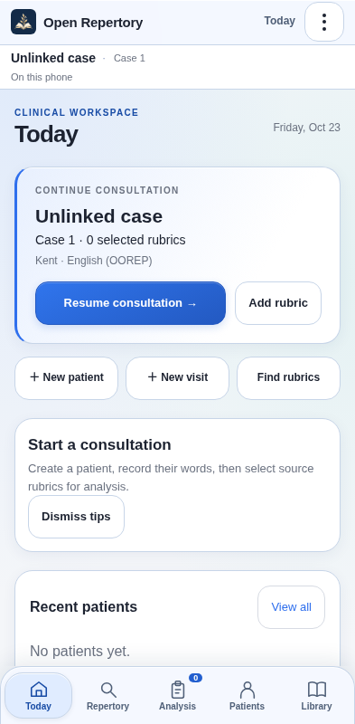
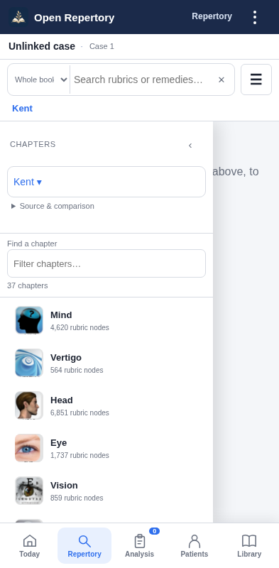
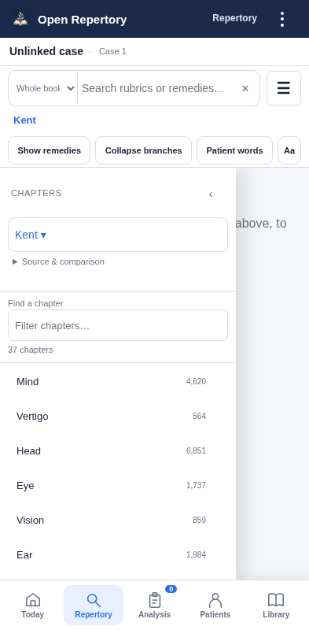
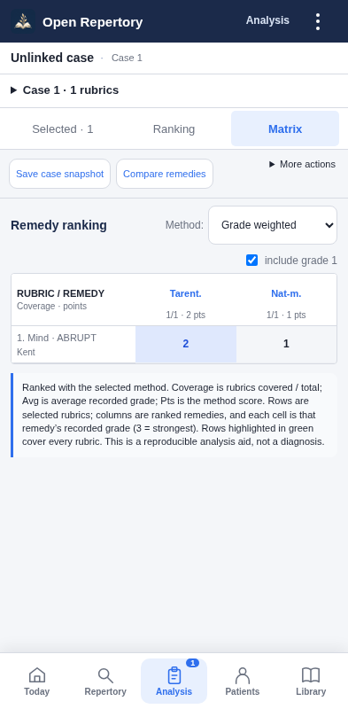

# Open Repertory — free APK updates

Download: **[Latest release](https://github.com/devil01529/Openrepertory-update/releases/latest)**

Install the APK over your existing Open Repertory installation. **Do not uninstall or clear app storage.** The first updater-enabled release is 1.19. **Version 1.27** adds a coordinated glass-inspired interface with readable clinical surfaces and a saved solid-mode switch. From an updater-enabled version, open **⋮ → App updates → Check for updates** to get it.

Android asks you to allow installation and confirm the update. Existing Apper login and owner approval remain required. Public APK downloads do not grant access to clinical records.

## For the owner

Read the **[step-by-step owner and developer guide](UPDATE_OWNER_GUIDE.md)**. A developer prepares the tested APK and signed `update.json`; you can upload these files to a GitHub Release from a phone or computer. Publish a normal release, set it as Latest, and retain the exact filenames.

This repository hosts public APK release files, public verification material, update components and release tooling. It contains **no patient records, account passwords, publishing tokens or private signing keys**. It is not the full clinical app source or a standalone app build.

## Cost and behaviour

GitHub's standard free public release hosting is used, subject to its policies and service limits. Users need no GitHub account or subscription. Update checks run after approved access, at most once a day; manual checks are immediate. Downloads start when the user chooses. There is no silent installation or paid push server. Existing Apper service costs/limits remain separate.

## Release integrity

The native app pins a public RSA verification key. It validates release signatures, HTTPS destinations, download hash/size, package, version, Android compatibility and the existing APK signing identity before handing the APK to Android. Never replace a published release with different files; issue a corrected release under a higher Android version code.

Keep the existing Android keystore and the separate metadata signing key in secure owner-controlled storage, outside this repository. See the guide before changing the repository URL or verification keys.

## New in 1.31

Adds audited, owner-authorized Boericke, BBCR and Allen 1891 TPB data. Kent is unchanged. Earlier OCR editions remain available for existing cases. Source anomalies are retained for review and excluded from scoring; higher grades survive case saves and encrypted backups. TPB's source is marked under development. This is a full API-record audit, not printed-book scan certification.

**529 counted automated checks passed**, plus exhaustive source comparison. Phatak, Synthetic and Complete await authorized structured exports.

[Download 1.31](https://github.com/devil01529/Openrepertory-update/releases/download/v1.31/Open-Repertory-1.31.apk) · [Comparison](REPERTORY_COMPARISON_1.31.md) · [Guide](CLINICAL_UI_GUIDE_1.31.md) · [Validation](TEST_REPORT_1.31.md)

## New in 1.30

Materia Medica’s section dropdown is now an app-styled, searchable picker with compact rows, selected-section checkmark, large-text support and reduced-motion handling. It closes and jumps directly to the chosen source heading.

**377 browser/package checks passed**. Source data and native classes are unchanged. Android instrumentation was not rerun in this iteration.

[Download 1.30](https://github.com/devil01529/Openrepertory-update/releases/download/v1.30/Open-Repertory-1.30.apk) · [Guide](CLINICAL_UI_GUIDE_1.30.md) · [Validation](TEST_REPORT_1.30.md)

## New in 1.29

The top backup reminder and patient/case strip are removed. Switch context inside Today’s consultation card. Backups remain in the menu and Today; interrupted-work recovery is retained.

Materia Medica opens on source text, with **Read / Case links / My notes** views, author selection and a **Jump to section** picker. The compact browser retains search, aliases, source-only filtering, notes sorting and remedy comparison.

**678 browser/package checks passed**. Clinical source data and native authentication/session code remain unchanged. No new physical-device frame-rate or Android instrumentation claim is made.

[Download 1.29](https://github.com/devil01529/Openrepertory-update/releases/download/v1.29/Open-Repertory-1.29.apk) · [Guide](CLINICAL_UI_GUIDE_1.29.md) · [Phased plan](MATERIA_MEDICA_PLAN_1.29.md) · [Validation](TEST_REPORT_1.29.md)

## New in 1.28

**Repertory → Aa Repertory & reading** now opens all reading controls directly above the book workspace. Both reading entries have been removed from the main menu. The button appears only on Repertory. Saved text, remedies, branches, finder, privacy and glass settings remain available.

A lightweight entrance respects reduced motion. **554 browser/package checks passed**; this iteration does not claim new Android instrumentation or physical-device frame-rate measurements.

[Download 1.28](https://github.com/devil01529/Openrepertory-update/releases/download/v1.28/Open-Repertory-1.28.apk) · [Guide](CLINICAL_UI_GUIDE_1.28.md) · [Phased UI plan](UI_PLAN_1.28.md) · [Validation](TEST_REPORT_1.28.md)

## New in 1.27

A glass-inspired header, navigation dock/tablet rail, tools menu, tabs, cards and dialogs. Light/dark/automatic themes, restrained highlights and clear active states. Clinical reading, remedy grades, analysis values, forms and privacy shields stay opaque.

**Menu → Repertory & reading → Glass effects** controls translucency. Turn it off for solid materials; older Android WebViews use a solid fallback automatically. Existing text sizing, chapter pictures/scrolling, rubric selection/clipboard, source switching, analysis, records, backups, warm sessions and owner approval remain available. Presentation-mode exit now immediately restores consultation labels.

[Guide](CLINICAL_UI_GUIDE_1.27.md) · [Four-phase plan](LIQUID_GLASS_PLAN_1.27.md) · [Independent review](LIQUID_GLASS_REVIEW_1.27.md) · [Reading menu](docs/glass-reading-1.27.png) · [Dark repertory](docs/glass-repertory-dark-1.27.png) · [Dark analysis](docs/glass-analysis-dark-1.27.png)

**1354 automated checks passed**, including two independent browser reviews and actual Android WebView 66, device lock/unlock, approval and owner-management regressions. Upgrade from 1.26 to the final APK retains 7 encrypted records and phone identity. [Test report](TEST_REPORT_1.27.md).

[Download v1.27](https://github.com/devil01529/Openrepertory-update/releases/download/v1.27/Open-Repertory-1.27.apk) · [Source overlay](https://github.com/devil01529/Openrepertory-update/releases/download/v1.27/Open-Repertory-1.27-Clinical-UI-Source.zip)

## New in 1.26

Chapter pictures are back. The whole drawer scrolls, including the controls above the chapters. **Menu → Repertory & reading** contains A−/A+ text sizing (80–140%), Reset, remedies, branches, patient words and reading/privacy settings. The repertory top strip is clearer. Analysis explanation/heading colors follow the light/dark theme.

Warm background returns on an unlocked phone preserve the clinical document/page, reading position and case without a login cover or one-minute relock. Owner approval refreshes quietly. Device locking still hides the workspace and blocks clinical access; Android unlock can resume a previously authenticated surviving session after approval revalidation. Cold starts still require authentication.

[Usage guide](CLINICAL_UI_GUIDE_1.26.md) · [Implementation plan](UI_SESSION_PLAN_1.26.md) · [Reading menu](docs/clinical-reading-1.26.png) · [Dark analysis](docs/clinical-analysis-dark-1.26.png) · [Test report](TEST_REPORT_1.26.md): **642 checks passed**, including actual Android screen lock/PIN unlock, native text zoom, warm-state retention and owner revocation. The 1.25 → final 1.26 upgrade retains 5 encrypted records and phone identity.

[Download v1.26](https://github.com/devil01529/Openrepertory-update/releases/download/v1.26/Open-Repertory-1.26.apk) · [Source overlay](https://github.com/devil01529/Openrepertory-update/releases/download/v1.26/Open-Repertory-1.26-Clinical-UI-Source.zip)

## New in 1.25

Today scrolls by touch and wheel to its final actions. Both book buttons use one short-name picker. Chapters use a compact text index with filtering and keyboard access; choosing the current chapter keeps it open and closes the panel. Rubric arrows show child counts, with **Collapse/Expand branches** and deferred child rendering. Slow-start recovery opens a late-ready workspace automatically. Clinical data, grades, mixed-source cases and Apper approval are retained.

[Detailed phased plan](REPERTORY_TREE_IMPROVEMENT_PLAN.md) · [Usage guide](CLINICAL_UI_GUIDE_1.25.md) · [Book picker](docs/clinical-books-1.25.png) · [Rubric branches](docs/clinical-tree-1.25.png) · [Test report](TEST_REPORT_1.25.md): **487 checks passed**. The published 1.24 → final 1.25 installation retains five encrypted records and phone identity. Verification includes actual Android swipe input and a deliberately delayed startup fixture.

[Download v1.25](https://github.com/devil01529/Openrepertory-update/releases/download/v1.25/Open-Repertory-1.25.apk) · [Source overlay](https://github.com/devil01529/Openrepertory-update/releases/download/v1.25/Open-Repertory-1.25-Clinical-UI-Source.zip)

## New in 1.24

Remedy lists start hidden; one button shows or hides them all. Rubrics and remedy lines are closer, chapters open automatically and close on selection, and the book picker shows names only. Analysis defaults to a compact rubric-row/remedy-column matrix; selected rubric weights remain horizontal. Cases can include different repertories while retaining every entry’s source and grades. Update notes open separately from download/install controls.

[Usage guide](CLINICAL_UI_GUIDE_1.24.md) · [Tablet analysis](docs/clinical-analysis-tablet-1.24.png) · [Test report](TEST_REPORT_1.24.md): **384 checks passed**, including source identity, score compatibility, responsive layouts, packaged Android workflows and long-note update controls. The final v1.23 → v1.24 upgrade retained five encrypted records and phone identity. Original clinical datasets are unchanged.

[Download v1.24](https://github.com/devil01529/Openrepertory-update/releases/download/v1.24/Open-Repertory-1.24.apk) · [Source overlay](https://github.com/devil01529/Openrepertory-update/releases/download/v1.24/Open-Repertory-1.24-Clinical-UI-Source.zip)

## New in 1.23

This release also fixes shared-path source switching: viewing another repertory cannot remove or alter rubrics in a case tied to its original source. The loading cover also prepares its first clinical frame on older Android WebViews. The earlier 1.22 was withdrawn from the stable channel after this review.

A consultation-first Today screen, patient/case strip, repertory workspace, separate analysis views, adaptive tablet panes, patient file tabs, private remedy notes, reading preferences and presentation mode. The floating shortcut is now **only a clipboard icon**.

[Usage guide](CLINICAL_UI_GUIDE_1.23.md) · [Analysis screen](docs/clinical-analysis-1.23.png) · [Tablet patient workspace](docs/clinical-patient-tablet-1.23.png)

English Kent is now a separate source from legacy Publicum. **All 68,742 source rows and 624,010 remedy records/grades** match the cached OOREP API. Five explicit cross-reference occurrences and 103 source-recorded alternate remedy names are integrated. Existing Publicum clinical data and case source keys are retained. This is an electronic-source audit, not printed-book scan certification.

[Full Kent audit](KENT_OOREP_AUDIT_1.23.md) · [Clinical audit snapshot](https://github.com/devil01529/Openrepertory-update/releases/download/v1.23/Kent-OOREP-2026-10-22-Audit-Snapshot.zip)

## Verification

[1.23 test report](TEST_REPORT_1.23.md): **500 automated checks passed**, including exhaustive source comparison and actual Android UI/access/startup/owner tests. An in-place v1.21 → v1.23 installation retained five encrypted records, phone identity and the legacy Publicum case source key. Package/signing identity and permissions are retained. Physical-phone clinician testing and a fresh live Apper credential sign-in are outside this test scope.

[Download the 1.23 source overlay](https://github.com/devil01529/Openrepertory-update/releases/download/v1.23/Open-Repertory-1.23-Clinical-UI-Source.zip). Apply it over the retained full application source; preserve existing signing keys privately.

## New in 1.21

Select a repertory rubric with **+ Add**. The floating **clipboard Analysis** button shows the current case count; tap it to open the existing full Analysis screen. It hides while typing or using a dialog and stays above bottom navigation.

[Major clinical UI redesign plan](MAJOR_UI_REDESIGN_PLAN.md) · [Visual concept](docs/clinical-workspace-concept.png). The complete redesign is planned; only the shortcut is implemented in this release.

## New in 1.20

Seven grouped phone-menu actions replace the long list. Appearance/Online AI are in Settings; primary pages remain in the bottom bar. Account access, Backup and App updates stay directly accessible. No clinical data or features are removed.

[1.20 test report](TEST_REPORT_1.20.md): 204 pre-release checks passed, including installed menu/Back/access/startup/owner tests and native live download verification. See the report for test scope and physical-phone acceptance.

The live v1.19 → v1.20 update was also verified end to end: discovery, native download/signature/hash verification, Android installation, encrypted-record/phone-identity retention, and installed APK hash matching the tested release. On v1.19, select **App updates → Check for updates → Download update → Install update**.

The public v1.23 update metadata signature and APK download were verified after publication; the downloaded bytes match the tested APK exactly. [Public verification record](PUBLIC_RELEASE_VERIFICATION_1.23.json).

The public v1.24 Latest metadata signature and APK bytes were verified after publication. [Verification record](PUBLIC_RELEASE_VERIFICATION_1.24.json).

The public v1.25 Latest metadata signature and APK bytes were verified after publication. [Verification record](PUBLIC_RELEASE_VERIFICATION_1.25.json).

## Public release verification

[GitHub release job](https://github.com/devil01529/Openrepertory-update/actions/runs/39916709385) published version 1.26. An anonymous download from the Latest channel verified the metadata signature and downloaded APK against the tested build: versionCode 27, 26,835,436 bytes, SHA-256 `a65c30a9b181adb84bf9acd80d8a95a40120141995d9a1390e8084f307a40962`. See [verification record](PUBLIC_RELEASE_VERIFICATION_1.26.json).

## Public 1.27 release verification

[GitHub release job](https://github.com/devil01529/Openrepertory-update/actions/runs/39952491482) completed successfully and published version 1.27 as Latest. An anonymous download verified the metadata signature and exact tested APK: versionCode 28, 26,839,609 bytes, SHA-256 `7c52fcba9d38de398bf5a4edc18106c3c254c11491b74085c7a501005d96605a`. See [verification record](PUBLIC_RELEASE_VERIFICATION_1.27.json).
