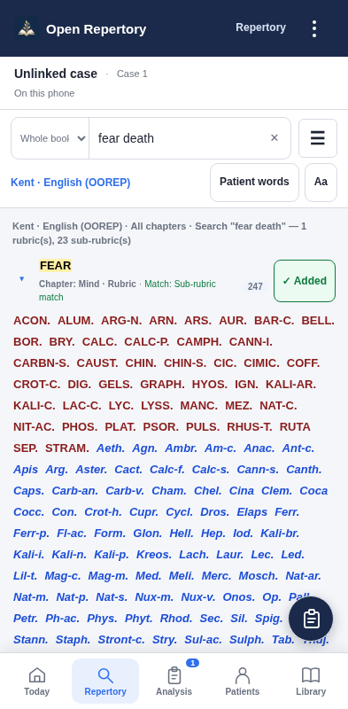

# Open Repertory — free APK updates

Download: **[Latest release](https://github.com/devil01529/Openrepertory-update/releases/latest)**

Install the APK over your existing Open Repertory installation. **Do not uninstall or clear app storage.** The first updater-enabled release is 1.19. **Version 1.23** delivers the clinical UI redesign and adds the audited English Kent source. From an updater-enabled version, open **⋮ → App updates → Check for updates** to get it.

Android asks you to allow installation and confirm the update. Existing Apper login and owner approval remain required. Public APK downloads do not grant access to clinical records.

## For the owner

Read the **[step-by-step owner and developer guide](UPDATE_OWNER_GUIDE.md)**. A developer prepares the tested APK and signed `update.json`; you can upload these files to a GitHub Release from a phone or computer. Publish a normal release, set it as Latest, and retain the exact filenames.

This repository hosts public APK release files, public verification material, update components and release tooling. It contains **no patient records, account passwords, publishing tokens or private signing keys**. It is not the full clinical app source or a standalone app build.

## Cost and behaviour

GitHub's standard free public release hosting is used, subject to its policies and service limits. Users need no GitHub account or subscription. Update checks run after approved access, at most once a day; manual checks are immediate. Downloads start when the user chooses. There is no silent installation or paid push server. Existing Apper service costs/limits remain separate.

## Release integrity

The native app pins a public RSA verification key. It validates release signatures, HTTPS destinations, download hash/size, package, version, Android compatibility and the existing APK signing identity before handing the APK to Android. Never replace a published release with different files; issue a corrected release under a higher Android version code.

Keep the existing Android keystore and the separate metadata signing key in secure owner-controlled storage, outside this repository. See the guide before changing the repository URL or verification keys.

## New in 1.23

This release also fixes shared-path source switching: viewing another repertory cannot remove or alter rubrics in a case tied to its original source. The loading cover also prepares its first clinical frame on older Android WebViews. The earlier 1.22 was withdrawn from the stable channel after this review.

A consultation-first Today screen, patient/case strip, repertory workspace, separate analysis views, adaptive tablet panes, patient file tabs, private remedy notes, reading preferences and presentation mode. The floating shortcut is now **only a clipboard icon**.

[Usage guide](CLINICAL_UI_GUIDE_1.23.md) · [Analysis screen](docs/clinical-analysis-1.23.png) · [Tablet patient workspace](docs/clinical-patient-tablet-1.23.png)

English Kent is now a separate source from legacy Publicum. **All 68,742 source rows and 624,010 remedy records/grades** match the cached OOREP API. Five explicit cross-reference occurrences and 103 source-recorded alternate remedy names are integrated. Existing Publicum clinical data and case source keys are retained. This is an electronic-source audit, not printed-book scan certification.

[Full Kent audit](KENT_OOREP_AUDIT_1.23.md) · [Clinical audit snapshot](https://github.com/devil01529/Openrepertory-update/releases/download/v1.23/Kent-OOREP-2026-10-22-Audit-Snapshot.zip)

## Verification

[1.23 test report](TEST_REPORT_1.23.md): **500 automated checks passed**, including exhaustive source comparison and actual Android UI/access/startup/owner tests. An in-place v1.21 → v1.23 installation retained five encrypted records, phone identity and the legacy Publicum case source key. Package/signing identity and permissions are retained. Physical-phone clinician testing and a fresh live Apper credential sign-in are outside this test scope.

[Download the 1.23 source overlay](https://github.com/devil01529/Openrepertory-update/releases/download/v1.23/Open-Repertory-1.23-Clinical-UI-Source.zip). Apply it over the retained full application source; preserve existing signing keys privately.

## New in 1.21

Select a repertory rubric with **+ Add**. The floating **clipboard Analysis** button shows the current case count; tap it to open the existing full Analysis screen. It hides while typing or using a dialog and stays above bottom navigation.

[Major clinical UI redesign plan](MAJOR_UI_REDESIGN_PLAN.md) · [Visual concept](docs/clinical-workspace-concept.png). The complete redesign is planned; only the shortcut is implemented in this release.

## New in 1.20

Seven grouped phone-menu actions replace the long list. Appearance/Online AI are in Settings; primary pages remain in the bottom bar. Account access, Backup and App updates stay directly accessible. No clinical data or features are removed.

[1.20 test report](TEST_REPORT_1.20.md): 204 pre-release checks passed, including installed menu/Back/access/startup/owner tests and native live download verification. See the report for test scope and physical-phone acceptance.

The live v1.19 → v1.20 update was also verified end to end: discovery, native download/signature/hash verification, Android installation, encrypted-record/phone-identity retention, and installed APK hash matching the tested release. On v1.19, select **App updates → Check for updates → Download update → Install update**.

The public v1.23 update metadata signature and APK download were verified after publication; the downloaded bytes match the tested APK exactly. [Public verification record](PUBLIC_RELEASE_VERIFICATION_1.23.json).
