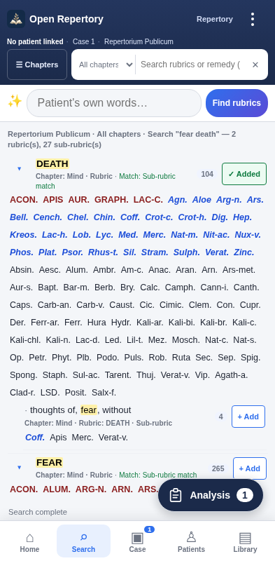
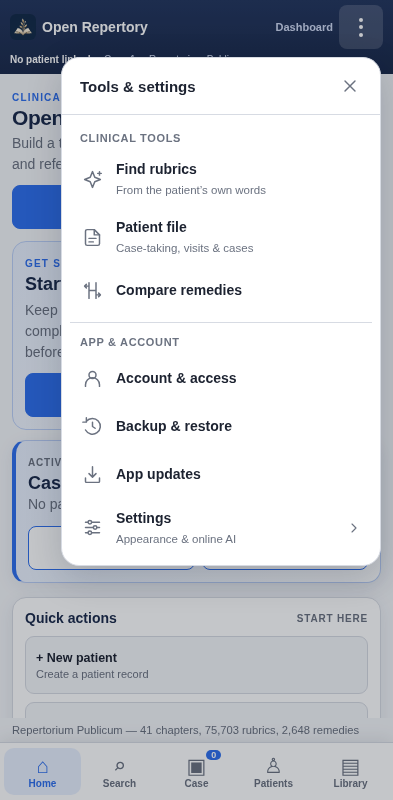

# Open Repertory — free APK updates

Download: **[Latest release](https://github.com/devil01529/Openrepertory-update/releases/latest)**

Install the APK over your existing Open Repertory installation. **Do not uninstall or clear app storage.** The first updater-enabled release is 1.19. **Version 1.21** adds the floating clipboard Analysis shortcut. From an updater-enabled version, open **⋮ → App updates → Check for updates** to get it.

Android asks you to allow installation and confirm the update. Existing Apper login and owner approval remain required. Public APK downloads do not grant access to clinical records.

## For the owner

Read the **[step-by-step owner and developer guide](UPDATE_OWNER_GUIDE.md)**. A developer prepares the tested APK and signed `update.json`; you can upload these files to a GitHub Release from a phone or computer. Publish a normal release, set it as Latest, and retain the exact filenames.

This repository hosts public APK release files, public verification material, update components and release tooling. It contains **no patient records, account passwords, publishing tokens or private signing keys**. It is not the full clinical app source or a standalone app build.

## Cost and behaviour

GitHub's standard free public release hosting is used, subject to its policies and service limits. Users need no GitHub account or subscription. Update checks run after approved access, at most once a day; manual checks are immediate. Downloads start when the user chooses. There is no silent installation or paid push server. Existing Apper service costs/limits remain separate.

## Release integrity

The native app pins a public RSA verification key. It validates release signatures, HTTPS destinations, download hash/size, package, version, Android compatibility and the existing APK signing identity before handing the APK to Android. Never replace a published release with different files; issue a corrected release under a higher Android version code.

Keep the existing Android keystore and the separate metadata signing key in secure owner-controlled storage, outside this repository. See the guide before changing the repository URL or verification keys.

## Verification

[1.21 test report](TEST_REPORT_1.21.md): 281 automated checks passed, including actual Android WebView shortcut/menu tests. An in-place v1.20 → v1.21 installation preserved six encrypted records and the phone identity. Clinical data/text assets and scoring are retained. Physical-phone acceptance and a fresh live Apper sign-in were not part of this UI change. The live Latest endpoint and anonymous APK download were verified after publication; signature and APK hash match the tested release.

[Download the 1.21 source overlay](https://github.com/devil01529/Openrepertory-update/releases/download/v1.21/Open-Repertory-1.21-UI-Source.zip); apply it over the retained full application source. It is not a standalone clinical database/source distribution.

## New in 1.21

Select a repertory rubric with **+ Add**. The floating **clipboard Analysis** button shows the current case count; tap it to open the existing full Analysis screen. It hides while typing or using a dialog and stays above bottom navigation.

[Major clinical UI redesign plan](MAJOR_UI_REDESIGN_PLAN.md) · [Visual concept](docs/clinical-workspace-concept.png). The complete redesign is planned; only the shortcut is implemented in this release.

## New in 1.20

Seven grouped phone-menu actions replace the long list. Appearance/Online AI are in Settings; primary pages remain in the bottom bar. Account access, Backup and App updates stay directly accessible. No clinical data or features are removed.

[1.20 test report](TEST_REPORT_1.20.md): 204 pre-release checks passed, including installed menu/Back/access/startup/owner tests and native live download verification. See the report for test scope and physical-phone acceptance.

The live v1.19 → v1.20 update was also verified end to end: discovery, native download/signature/hash verification, Android installation, encrypted-record/phone-identity retention, and installed APK hash matching the tested release. On v1.19, select **App updates → Check for updates → Download update → Install update**.
